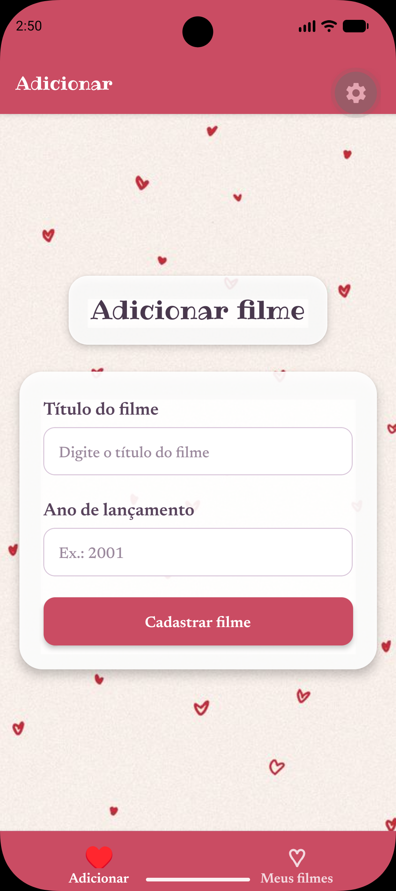

# 🎬 Lista de Filmes

> Aplicativo mobile para organização de filmes, desenvolvido com React Native e Expo.

O **Lista de Filmes** é um projeto de desenvolvimento mobile que permite organizar uma lista pessoal de filmes, consultar detalhes e acompanhar quais já foram assistidos. A aplicação utiliza componentes funcionais, Hooks do React e navegação entre telas para estruturar suas funcionalidades.

---

## 🎨 Demonstração

<p align="center">
  
  &nbsp;&nbsp;
  
  &nbsp;&nbsp;
  
</p>

<p align="center">
  <em>Listagem de filmes, cadastro e visualização de detalhes.</em>
</p>

---

## ✨ Funcionalidades

- **Listagem de filmes:** visualização dos filmes cadastrados;
- **Cadastro:** adição de novos filmes à lista;
- **Detalhes:** consulta das informações de um filme selecionado;
- **Controle de filmes assistidos:** marcação dos filmes já assistidos;
- **Exclusão:** remoção de filmes da lista;
- **Navegação:** acesso às diferentes telas do aplicativo.

---

## 🛠️ Tecnologias

| Tecnologia | Utilização |
|---|---|
| JavaScript | Linguagem de programação |
| React Native | Construção da interface mobile |
| Expo | Ambiente de desenvolvimento e execução |
| React Navigation | Navegação entre telas |
| React Hooks | Gerenciamento de estado e comportamento dos componentes |
| Expo Font e Expo Google Fonts | Utilização de fontes personalizadas |
| Git e GitHub | Versionamento e hospedagem do código |

---

## 🏗️ Organização do código

O projeto está organizado em componentes de tela e módulos de navegação, separando a apresentação das interfaces da organização dos fluxos de navegação.

| Arquivo | Responsabilidade |
|---|---|
| `App.js` | Componente principal e gerenciamento da lista de filmes |
| `TelaFilmes.js` | Exibição da lista de filmes |
| `TelaAdicionar.js` | Interface de cadastro de filmes |
| `TelaDetalhes.js` | Apresentação dos detalhes de um filme |
| `NavegacaoPrincipal.js` | Organização da navegação principal |
| `NavegacaoFilmes.js` | Navegação relacionada às telas de filmes |

### Estrutura do projeto

```text
ListaFilmes/
├── assets/
│   └── images/
├── docs/
│   ├── telaFilmes.png
│   ├── telaAdicionar.png
│   └── telaDetalhes.png
├── navegacao/
│   ├── NavegacaoPrincipal.js
│   └── NavegacaoFilmes.js
├── App.js
├── index.js
├── TelaFilmes.js
├── TelaAdicionar.js
├── TelaDetalhes.js
├── app.json
├── package.json
├── package-lock.json
└── README.md
```

---

## 🚀 Como executar

### Pré-requisitos

- Node.js e npm;
- Expo Go em um dispositivo compatível ou emulador Android configurado.

### 1. Clone o repositório

```bash
git clone <URL_DO_REPOSITORIO>
```

### 2. Acesse a pasta do projeto

```bash
cd ListaFilmes
```

### 3. Instale as dependências

```bash
npm install
```

### 4. Inicie o aplicativo

```bash
npx expo start
```

Após iniciar o servidor de desenvolvimento, escaneie o QR Code com o Expo Go ou pressione `a` no terminal para abrir o aplicativo em um emulador Android configurado.

---

## 📚 Aprendizados

O desenvolvimento do projeto permitiu aplicar conceitos de desenvolvimento mobile, incluindo:

- Criação e composição de componentes funcionais;
- Gerenciamento de estado com Hooks;
- Navegação entre telas;
- Manipulação e atualização de listas;
- Separação de responsabilidades entre componentes e módulos;
- Personalização de interfaces com imagens e fontes.

---

## 🎓 Contexto acadêmico

Projeto desenvolvido no contexto de uma atividade acadêmica de **Laboratório de Programação**, na Universidade Estadual de Londrina (UEL).

---

## 📖 Referências

- [React Native](https://reactnative.dev/)
- [Expo](https://docs.expo.dev/)
- [React Navigation](https://reactnavigation.org/)

---

## 👩‍💻 Autora

**Letícia Videira Gois**

Ciência da Computação — Universidade Estadual de Londrina (UEL)
